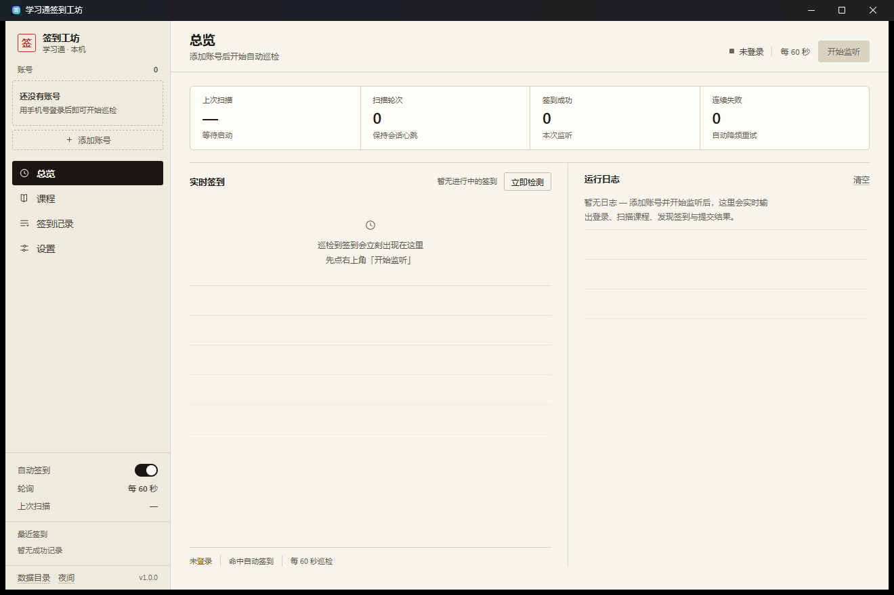
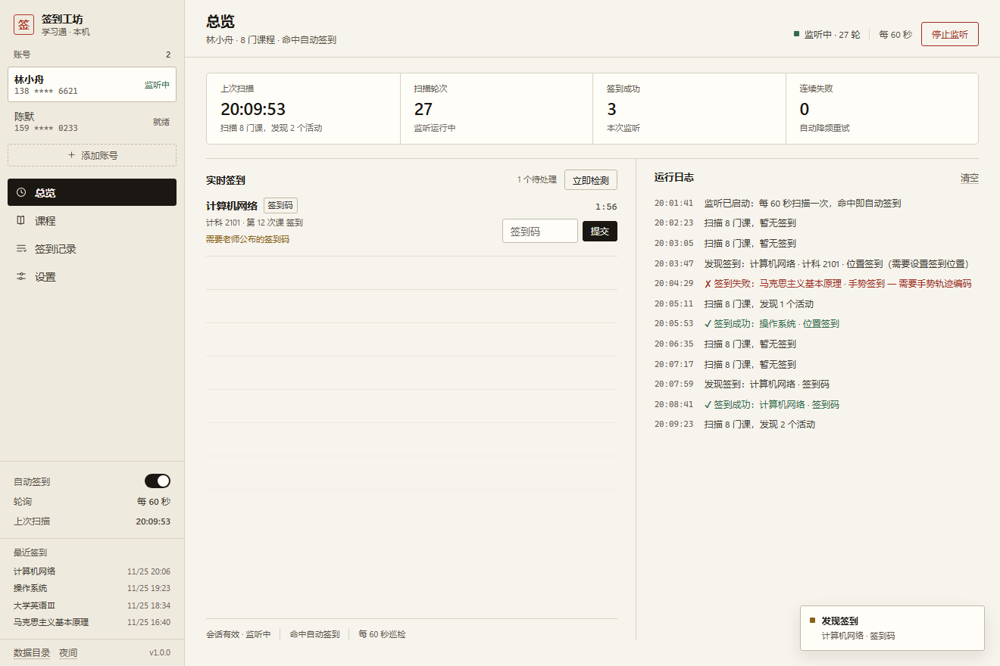
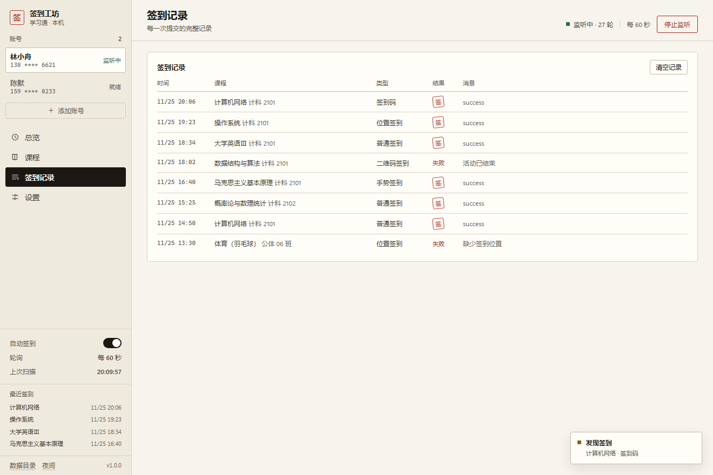
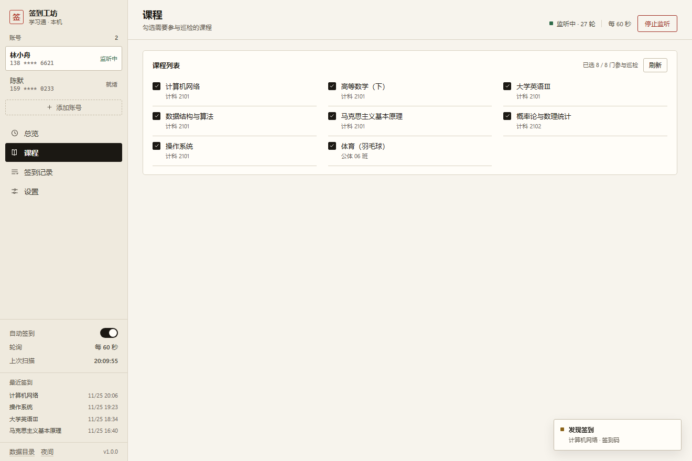
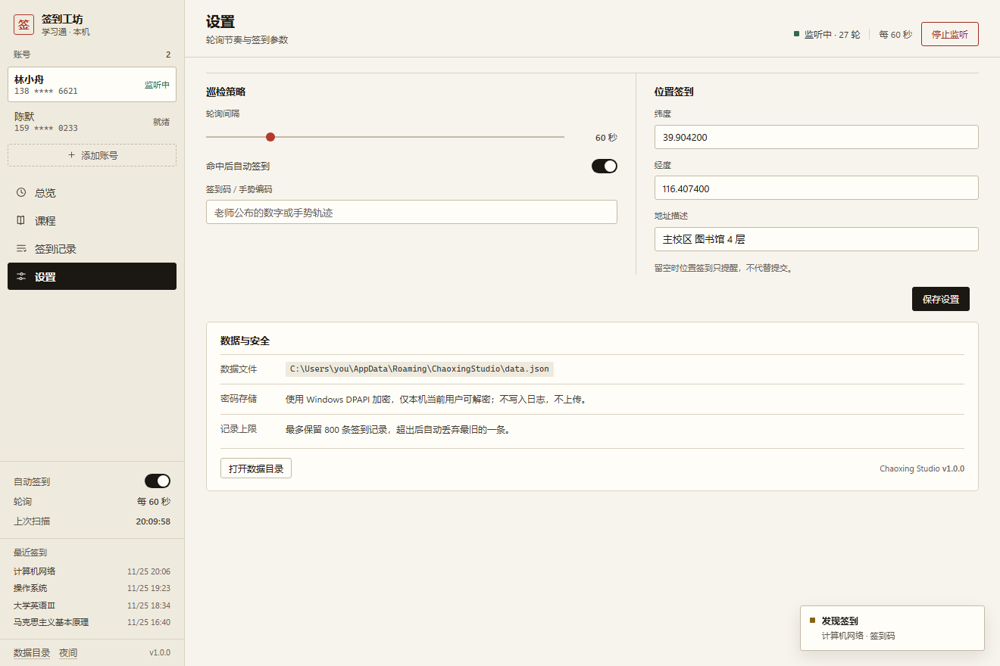
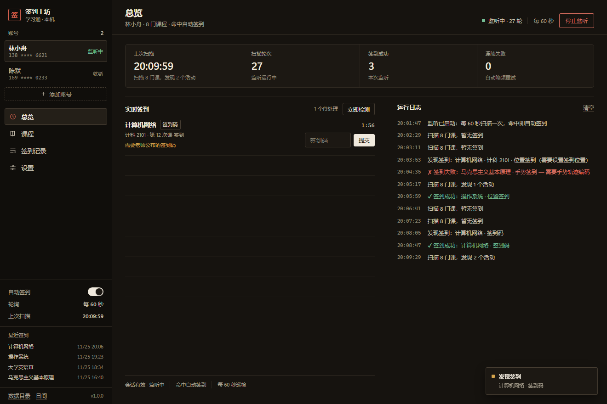
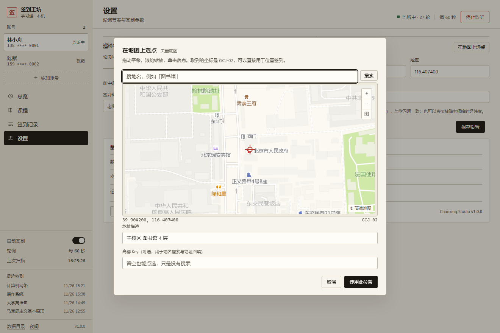

# 学习通签到工坊 · Chaoxing Studio

一个 Windows 桌面版的超星学习通签到助手：**本地运行、无浏览器依赖、无云服务**。基于 Go + Wails v2 + 原生 WebView2，单文件 exe 即可运行。

界面是一张**点名册**：纸白底、发丝横线、等宽数字、朱红印章。签到成功时在记录上落一枚「签」印；右上角切换「夜间」进入墨色版本，同一套排版反相，选择记在 `localStorage`。



| 总览 | 签到记录 |
| --- | --- |
|  |  |
| **课程** | **设置** |
|  |  |

夜间模式（同一套排版整体反相，不是另一套深色皮肤）：



位置签到的地图选点（拖动平移、滚轮缩放、单击落点，取到的坐标就是 GCJ-02）：



## 下载

不想自己编译的话，直接用 Releases 里的成品：

**[ChaoxingStudio.exe](https://github.com/X1Rain0/chaoxing-studio/releases/latest/download/ChaoxingStudio.exe)** · 免安装，约 11.6 MB，解压后双击即用（需要 WebView2 Runtime，Win10/11 一般已内置）。

---

## 功能

| 能力 | 说明 |
| --- | --- |
| 多账号 | 手机号 + 密码登录，账号并存，可单独启用/停用，密码经 **Windows DPAPI** 加密后落盘 |
| 自动巡检 | 按设定间隔（默认 60 秒）轮询所选课程的活动列表，发现进行中的签到 |
| 全类型签到 | 普通 / 拍照 / 二维码 / 手势 / 位置 / 签到码 六种，按类型自动选取提交参数 |
| 自动预签到 | 提交前先走 `preSign → analysis → analysis2` 换码，必要时带 400ms 节流 |
| 位置签到 | **内置地图选点**：高德瓦片底图，拖动/滚轮/单击取点，坐标直接写回；也可手填经纬度 |
| 手势/签到码 | 可全局预设，也可在活动卡上**行内输入**当场提交（Enter 直接签） |
| 实时反馈 | 界面事件流：日志、活动发现、签到结果；WebAudio 提示音 + 页面 toast + 标题闪烁 |
| 记录留存 | 签到记录最多保留 800 条，表格可按时间/结果查看，可一键清空 |
| 会话自愈 | cookie 失效自动重登一次并重放请求；网络错误与 5xx 退避重试 |
| 失败退避 | 连续 3 次失败后拉长轮询间隔，最长 300 秒，避免空转拖慢 |
| 崩溃可见 | 无控制台也能看到错误：启动失败弹系统消息框，而不是静默退出 |

## 快速开始

1. 双击 `ChaoxingStudio.exe`（**需要 WebView2 Runtime**，Win10/11 一般已内置）。
2. 点「添加账号」，输入手机号与学习通密码 → 登录后会拉取课程列表。
3. 在「课程」页勾选要巡检的课，回到「总览」点「开始监听」。
4. 遇到位置签到，去「设置 → 位置签到」点「在地图上选点」，点一下教学楼的位置即可（也可以直接粘贴老师给的经纬度）。
5. 发现签到会在「实时签到」卡片出现，缺参数时卡片上会提示；自动签到关闭时只提醒不提交。

**数据位置**（设置页底部可直接打开）：

| 用途 | 路径 |
| --- | --- |
| 账号 / 记录 / 设置 | `%APPDATA%\ChaoxingStudio\data.json` |
| WebView2 缓存 | `%LOCALAPPDATA%\ChaoxingStudio\WebView2` |

若上述位置不可写（例如把 exe 放在带低完整性标签的沙箱目录），程序会自动回退到
`<exe 目录>\data`、`<exe 目录>\webview-data`、`%TEMP%\ChaoxingStudio*`，无需手工配置。

## 构建

环境：Go 1.27+、Wails CLI v2.17+、WebView2 Runtime。**不需要 Node / npm**——前端是手写的静态文件，直接 `go:embed` 进二进制。

```powershell
cd chaoxing-studio
$env:PATH="$env:USERPROFILE\go\bin;$env:PATH"
wails build -clean -platform windows/amd64     # 产物 build\bin\ChaoxingStudio.exe
```

图标由 Pillow 脚本生成（改配色后重跑即可）：

```powershell
python build\make_icon.py                      # 写 build\appicon.png + build\windows\icon.ico
```

冒烟验证（启动、截图、退出，不抢前台焦点）：

```powershell
.\build\smoke.ps1
```

界面截图（Edge headless 直接打开静态前端，带 mock 数据，不用启动应用）：

```powershell
.\build\shots.ps1 -Prefix v9      # 写 build\v9-{overview,courses,records,settings,ink}.png
```

## 目录结构

```
chaoxing-studio/
├── main.go                 # 窗口配置、WebView2 数据目录探测、错误弹窗
├── app.go                  # Wails 绑定层：参数校验 + 事件转发
├── internal/
│   ├── chaoxing/           # 协议层（不依赖 UI，可单独做 CLI）
│   │   ├── client.go       # HTTP 客户端、cookie jar、节流、重登重放
│   │   ├── login.go        # 登录（DES-ECB 加密密码）
│   │   ├── course.go       # 课程列表
│   │   ├── activity.go     # 活动发现（类型判定、时间窗过滤）
│   │   ├── sign.go         # 预签到 + 六种签到的提交逻辑
│   │   ├── pan.go          # 云盘取默认照片（拍照签到用）
│   │   ├── crypto.go       # DES-ECB / PKCS5
│   │   └── types.go        # 领域模型
│   ├── engine/             # 会话管理、轮询调度、事件广播、自动签到决策
│   ├── geo/                # 高德地名搜索 / 逆地理编码（Key 可选）
│   └── store/              # JSON 持久化 + DPAPI 加解密
├── frontend/dist/          # 手写静态前端（index.html / style.css / app.js / mock.js）
└── build/                  # 图标、冒烟脚本、产物
```

## 协议要点（供维护参考）

| 步骤 | 端点 | 关键参数 |
| --- | --- | --- |
| 登录 | `POST passport2.chaoxing.com/fanyalogin` | `uname`、`password`（DES-ECB 密钥 `u2oh6Vu^`，小写 hex）、`fid=-1` |
| 课程 | `GET mooc1-api.chaoxing.com/mycourse/backclazzdata?rss=1` | 取 `channelList[].content.id`（班级）与 `course.data[].id`（课程） |
| 活动 | `GET mobilelearn.chaoxing.com/v2/apis/active/student/activelist` | `fid=0`、`courseId`、`classId`、`_=毫秒` |
| 预签到 | `GET mobilelearn.chaoxing.com/newsign/preSign` | `activePrimaryId`、`general=1`、`sys=1`、`appType=15` |
| 取码 | `pptSign/analysis` → `pptSign/analysis2` | 从页面 `code='+'xxx'` 抠出，再回填 |
| 提交 | `GET mobilelearn.chaoxing.com/pptSign/stuSignajax` | 普通 `latitude=-1&longitude=-1`；位置 `address+经纬度+ifTiJiao=1`；拍照 `objectId`；二维码 `enc`+`location` JSON；手势/码 `signCode` |
| 码校验 | `widget/sign/pcStuSignController/checkSignCode` | 手势/签到码提交前必须先过，否则返回 90002 |

`otherId` 映射：`0` 普通（`getPPTActiveInfo` 返回 `ifphoto==1` 时为拍照）、`2` 二维码、`3` 手势、`4` 位置、`5` 签到码。

### 地图与坐标系

位置签到的地图是**零依赖手写 slippy map**（Web 墨卡托 + 256px 瓦片），底图取高德公开瓦片：

| 底图 | 地址 | 说明 |
| --- | --- | --- |
| 矢量 | `webrd0{1..4}.is.autonavi.com/appmaptile?style=8` | 默认，路名/POI 齐全 |
| 卫星 | `webst0{1..4}.is.autonavi.com/appmaptile?style=6` | 弹层右上「图」按钮切换 |

坐标系是 **GCJ-02**，与学习通、高德一致，所以地图上取到的数字可以直接提交，**不要**再做 WGS-84 转换。

地名搜索与逆地理编码走 `restapi.amap.com` 的 Web 服务，需要一个「Web服务」类型的 Key，填在弹层里的「高德 Key（可选）」输入框，会存进 `data.json` 的 `amapKey`。
**不填 Key 也能正常选点**，只是没有搜索结果和地址自动回填。

## 已知限制

- 只支持**手机号 + 密码**登录；扫码登录未实现。
- 二维码签到需要拿到 `enc`（活动详情里的加密串），过期即失效，不能缓存。
- 拍照签到使用个人云盘根目录的 `0.jpg` / `0.png` 作为签到照片，需事先上传。
- 地图底图来自高德公开瓦片，离线或网络受限时只显示灰底，不影响手填经纬度。
- 接口属于非公开 API，学习通侧调整参数或校验后可能失效，届时改 `internal/chaoxing/` 对应文件即可，UI 层无需改动。
- 需要系统已安装 WebView2 Runtime（大部分 Win10/11 自带）。

## 技术栈

- **Go 1.27** — 协议层、调度引擎、持久化
- **Wails v2.17** — 原生窗口 + Go↔JS 绑定 + 事件推送
- **WebView2 (Chromium)** — 渲染层
- **零前端依赖** — 手写 HTML/CSS/JS，`go:embed` 进二进制，无 npm、无打包器
- **设计 token** — 颜色/字号/间距全部走 `:root` 变量，`[data-theme="ink"]` 只换 token 不换结构
- **Windows DPAPI** — 密码用 `CryptProtectData` 加密，仅当前用户可解密
